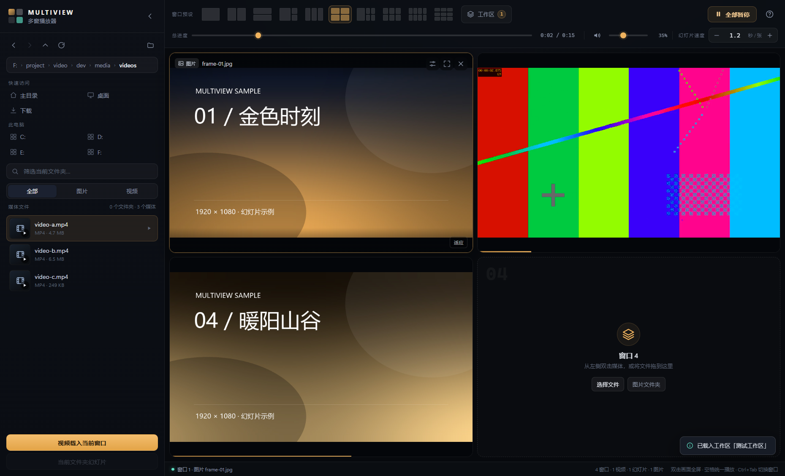
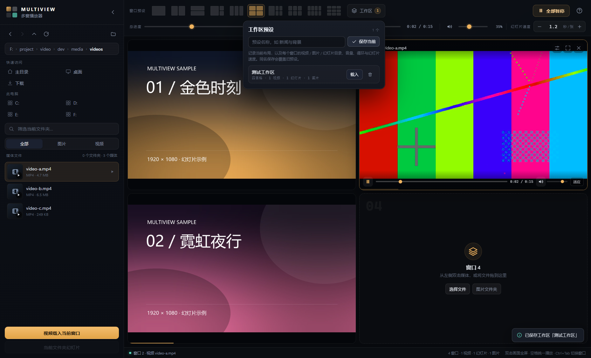

# Multiview 多窗播放器

一个面向 Windows 的本地多窗口媒体播放器：在同一个窗口里按不同布局同时播放多个视频和图片，统一或单独控制音量与进度，把文件夹变成自动轮播的图片幻灯片，并可以把整套布局和媒体选择保存成「工作区预设」。



## 功能

### 多窗口与布局

- 10 种布局预设：单窗口、左右双窗、上下双窗、主窗 + 双副窗、三联横排、四宫格、主窗 + 四宫格、六宫格、八宫格、九宫格。
- 每个窗口可以独立载入视频、单张图片，或整个图片文件夹的幻灯片。
- 支持把文件或文件夹直接拖进任意窗口；从文件浏览器拖入也可以。
- 双击窗口画面可全屏该窗口，`Esc` 退出。

### 统一与独立控制

- 顶部总进度条可同时跳转所有视频和幻灯片。
- 每个窗口底部有独立的播放 / 暂停、进度、音量、静音和「适应 / 铺满」切换。
- 顶部总音量会与每个窗口自己的音量相乘，适合先调好单窗响度，再统一收放。
- 「全部播放 / 全部暂停」一键控制所有窗口。

### 图片幻灯片

- 选择一个文件夹即可自动轮播其中的图片，支持包含子文件夹。
- 每张时长可精确到 0.1 秒：设置面板支持步进、快捷档位和直接输入；顶部还有统一的「幻灯片速度」。
- 播放顺序支持「顺序」和「随机」：
  - 顺序按文件名排列，包含子文件夹时按相对路径排列。
  - 随机每轮循环都会重新洗牌。
  - 幻灯片窗口底部有随机按钮，设置面板中也有「播放顺序」切换。
- 支持循环、多图淡入淡出、上一张 / 下一张，以及用当前位置的图片所在文件夹一键生成幻灯片。
- 单个文件夹最多读取 4000 张图片，避免超大目录卡顿。

### 工作区预设

- 顶部「工作区」按钮可以把当前状态命名保存：
  - 当前布局；
  - 每个窗口的视频文件、图片文件、幻灯片文件夹；
  - 每个窗口的音量、静音、画面模式、循环、幻灯片时长和播放顺序；
  - 总音量、总静音和统一幻灯片速度。
- 同名保存会覆盖旧预设，最多保存 30 个。
- 载入预设会恢复布局并自动开始播放；预设会跨重启保留。



### 文件浏览器

- 本地磁盘、快捷位置（主目录、桌面、图片、视频、下载）和盘符入口。
- 前进 / 后退 / 上一级 / 刷新，支持 Windows 路径和 UNC 路径。
- 图片缩略图、视频文件卡片、按图片 / 视频筛选、当前文件夹搜索。
- 双击载入当前窗口，或选中后点「载入到当前窗口」；「当前文件夹幻灯片」直接把整个文件夹变成幻灯片。

## 快捷键

| 按键 | 功能 |
| --- | --- |
| `空格` | 所有窗口统一播放 / 暂停 |
| `Ctrl + Tab` | 切换到下一个窗口（`Ctrl + Shift + Tab` 反向） |
| `←` / `→` | 当前参考窗口后退 / 前进 5 秒；幻灯片切换上一张 / 下一张 |
| `F` | 当前窗口全屏 / 退出全屏 |
| `M` | 总静音开关 |
| `Delete` / `Backspace` | 清空当前窗口 |
| `Esc` | 关闭弹出菜单 / 退出全屏 |

## 快速开始

### 直接运行便携版

1. 解压 `dist/Multiview-win32-x64.zip`。
2. 双击 `Multiview.exe`。

无需安装。设置和预设保存在 `%APPDATA%\Multiview 多窗播放器\state.json`。

### 从源码运行

需要 Node.js 18+ 和 Windows。

```bash
npm install
npm start
```

如果 Electron 二进制下载失败，可使用镜像重试：

```bash
ELECTRON_MIRROR=https://npmmirror.com/mirrors/electron/ node node_modules/electron/install.js
```

### 打包便携版

```bash
npm run pack
```

输出目录为 `dist/Multiview-win32-x64/`，入口为 `Multiview.exe`。打包使用 `@electron/packager`，并会自动排除 `dev/`、`dist/` 等开发目录。

## 支持的格式

| 类型 | 扩展名 |
| --- | --- |
| 图片 | JPG / JPEG / PNG / GIF / WebP / AVIF / BMP / SVG / ICO |
| 视频 | MP4 / M4V / WebM / OGV / OGG / MOV / MKV |

视频能否播放取决于 Electron 内置解码器和系统解码器，H.264 编码的 MP4 兼容性最好。MKV、MOV 等容器中的部分编码可能无法播放。

## 项目结构

```text
.
├─ main.js              Electron 主进程：窗口、文件系统 IPC、状态读写
├─ preload.js           contextBridge，向页面暴露受控的本地文件 API
├─ src/
│  ├─ index.html        应用外壳与工具栏
│  ├─ styles.css        深色界面、布局、窗口控件与弹出层样式
│  ├─ util.js           扩展名判断、格式化、路径与通用工具
│  ├─ icons.js          内置 SVG 图标
│  ├─ layouts.js        10 种布局预设
│  ├─ pane.js           单个媒体窗口：视频、图片、幻灯片引擎
│  ├─ browser.js        文件浏览器
│  └─ app.js            应用状态、总控、工作区预设与初始化
├─ assets/              应用图标（PNG / ICO）
├─ dev/                 测试脚本、测试素材与截图
└─ dist/                打包输出（不纳入版本管理）
```

## 实现说明

- 界面使用原生 HTML / CSS / JavaScript，无前端框架和打包步骤。
- 媒体通过本地 `file://` 地址直接交给 `<video>` / ``，前提是 Electron 窗口关闭了 `webSecurity`；页面本身通过 `contextIsolation` 与预加载脚本隔离。
- 幻灯片使用 `setTimeout` 调度和双层图片交叉淡入，播放顺序由一个独立的索引数组维护。
- 应用状态通过 IPC 写入 `%APPDATA%\Multiview 多窗播放器\state.json`，采用临时文件加改名的方式原子写入。
- 自动化测试使用 Playwright 的 Electron 驱动，测试素材由 ffmpeg / Pillow 生成。

## 已知限制

- 最多同时显示 9 个窗口。
- 单个幻灯片文件夹最多载入 4000 张图片。
- 没有播放列表编辑、字幕、倍速和音频轨道切换。
- 视频编码兼容性由 Electron / 系统解码器决定。

## 开发与测试

```bash
node dev/test-flow.mjs        # 基础布局、媒体载入、总控与全屏
node dev/test-workspace.mjs   # 工作区预设保存、载入与重启持久化
node dev/test-shuffle.mjs     # 幻灯片顺序 / 随机切换
node dev/test-packaged.mjs    # 打包后的可执行文件冒烟测试
```

截图输出在 `dev/shots/`。`dev/media/` 是本地生成的测试图片和视频，未纳入版本库；运行测试前需要按脚本中的路径自行准备（`dev/media/images`、`dev/media/videos`）。
